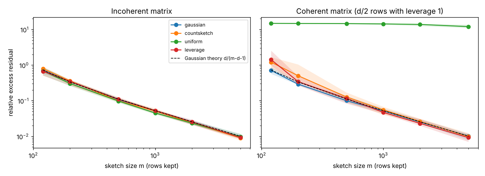
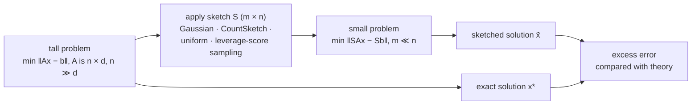

# randomized-sketching

[](https://github.com/John-Ferd/randomized-sketching/actions/workflows/ci.yml) 

Solving a huge least-squares problem by first compressing it. This repo implements four randomized "sketches" in NumPy/SciPy: Gaussian projection, CountSketch, uniform row sampling, and leverage-score sampling. It measures how close sketch-and-solve gets to the exact answer, and checks the measurements against theory.

## In one paragraph

To solve min ‖Ax − b‖ with A of size n × d and n ≫ d, multiply both sides by a random m × n matrix S (m ≪ n) and solve the small problem min ‖SAx − Sb‖ instead. If S approximately preserves the length of every vector in the column space of A (a *subspace embedding*), the small problem's answer is nearly as good as the big one's. The experiments show:
1. On a typical (incoherent) matrix, all four sketches reach 1% excess error with m = 100d rows. The Gaussian sketch matches its exact theoretical error curve.
2. On a *coherent* matrix, where a few rows matter enormously, uniform sampling fails completely (error ≈ 14× the optimum, and more rows barely help), while leverage-score sampling and the oblivious sketches still work.
3. CountSketch solves a 200,000 × 50 problem **19× faster** than NumPy's exact solver, for a 4.7% worse squared residual.

## Results

Problem size n = 20,000, d = 50. The table shows the median over 20 random sketches (`make experiments`). The error is the **relative excess residual** (‖Ax̃ − b‖² − ‖Ax* − b‖²) / ‖Ax* − b‖². For example, 0.05 means the sketched answer's squared residual is 5% above optimal.

**Incoherent matrix** (Gaussian rows, every row about equally important):

| m (rows kept) | Gaussian | CountSketch | uniform | leverage | Gaussian theory d/(m−d−1) |
|---|---|---|---|---|---|
| 120 | 0.715 | 0.796 | 0.680 | 0.670 | 0.725 |
| 500 | 0.107 | 0.099 | 0.098 | 0.110 | 0.111 |
| 1,000 | 0.051 | 0.051 | 0.045 | 0.053 | 0.053 |
| 5,000 | 0.0096 | 0.0090 | 0.0097 | 0.0092 | 0.0101 |

**Coherent matrix** (25 of the 20,000 rows each carry the only information about one coefficient, so each has leverage score 1):

| m | Gaussian | CountSketch | uniform | leverage |
|---|---|---|---|---|
| 120 | 0.70 | 1.21 | **14.8** | 1.42 |
| 500 | 0.100 | 0.127 | **14.6** | 0.115 |
| 1,000 | 0.052 | 0.055 | **14.3** | 0.047 |
| 5,000 | 0.010 | 0.010 | **12.0** | 0.009 |

<p align="center"></p>

- **The error falls like 1/m.** Doubling the sketch size roughly halves the excess error, as the Gaussian formula d/(m − d − 1) predicts. The measured Gaussian errors sit right on that curve, which is a check that the code is correct.
- **Why uniform sampling fails on the coherent matrix:** each of the 25 special rows is kept with probability only about m/n, so most are dropped. The coefficient they determine is then fit as 0, and no number of *other* rows can recover it. Leverage-score sampling picks those rows on purpose. Gaussian and CountSketch don't look at A at all but still spread every row's information across the sketch, so they work too.
- **Gaussian sketch as a subspace embedding:** for an orthonormal basis U of A's column space, the singular values of SU fall in 1 ± √(d/m). At m = 1,000, for example, the measured range is [0.785, 1.211] and the prediction is [0.776, 1.224] (`artifacts/embedding.png`).

**Speed** (n = 200,000, d = 50, m = 1,000, best of 3 runs on the 2-core cloud machine I used; times depend on hardware):

| method | time | excess residual |
|---|---|---|
| exact (NumPy `lstsq`) | 0.40 s | 0 |
| **CountSketch + solve** | **0.021 s** | 0.047 |
| Gaussian sketch + solve | 3.79 s | — |

CountSketch touches each row of A once (O(nd)), so it is much cheaper than the exact solve. The Gaussian sketch is *slower* than solving exactly, because forming GA is a dense m × n by n × d product, O(nmd). Gaussian sketches are the easiest to analyse, but CountSketch is the one you would actually use.

## Architecture



## How it works

**The four sketches** (`sketches.py`). Each satisfies E[SᵀS] = I, so ‖Sy‖² is an unbiased estimate of ‖y‖² for any fixed y (tested).

| sketch | what S does | cost to apply | looks at A? |
|---|---|---|---|
| Gaussian | S = G/√m, i.i.d. N(0,1) entries | O(nmd) | no |
| CountSketch | each row of A is added, times a random ±1, into one random row of the sketch | O(nnz(A)) | no |
| uniform sampling | keep m random rows, rescaled by √(n/m) | O(md) | no |
| leverage sampling | keep row i with probability ∝ ℓᵢ, rescaled by 1/√(m pᵢ) | O(md) after computing ℓ | yes |

**Leverage scores.** If A = QR, then ℓᵢ = ‖Qᵢ‖², the squared length of row i of an orthonormal basis for A's column space. The scores sum to d, and ℓᵢ = 1 means row i is the only row that constrains some direction. Sampling proportionally to ℓ means no direction gets missed.

**Why the Gaussian error is exactly d/(m − d − 1).** Write the optimal residual as r* = b − Ax*. It is orthogonal to the columns of A. For a Gaussian S, SA and Sr* are therefore independent, and

x̃ − x* = (AᵀSᵀSA)⁻¹ AᵀSᵀ S r*.

Taking expectations,

E‖A(x̃ − x*)‖² = ‖r*‖² · E[tr((AᵀSᵀSA)⁻¹ AᵀA)].

AᵀSᵀSA is a Wishart matrix, and the mean of an inverse Wishart matrix gives the trace as d/(m − d − 1). The test suite checks this formula by Monte Carlo, to within 15%.

Alternatives considered:
- *Iterative sketching* (using the sketch as a preconditioner for an exact iterative solver) reaches machine precision. Sketch-and-solve was chosen because it is the simplest setting in which to see the theory.
- *Approximate leverage scores* are what you'd use in practice, because computing exact scores via QR costs as much as solving the problem. They are listed as a limitation below.

## Tests

`make test` runs 10 tests:
- E‖Sy‖² = ‖y‖² for all four sketches.
- CountSketch matches its explicit matrix (exactly one ±1 per column).
- Leverage scores sum to d and find the spike rows.
- The two forms of the excess-residual formula agree.
- The Gaussian Monte-Carlo error matches d/(m − d − 1).
- Uniform sampling fails on the coherent matrix while leverage sampling works.
- The Gaussian embedding bounds hold.

## How to run

```bash
pip install -e ".[dev]"     # or: make setup
make test
make experiments            # ~4 minutes: tables above, artifacts/results.json, accuracy.png, embedding.png
```

## Layout

```
src/sketching/
├── sketches.py       # Gaussian, CountSketch, uniform, leverage sampling; leverage scores
├── least_squares.py  # exact solve, sketch-and-solve, error metric, Gaussian theory
└── data.py           # incoherent and coherent test matrices
scripts/run_experiments.py
tests/                # 10 tests
```

## Limitations

- Leverage scores are computed exactly with a QR factorization, which costs O(nd²), about the same as solving the problem. A practical version would estimate them from a sketch first.
- Only dense, synthetic matrices. CountSketch's real advantage, O(nnz) on sparse data, isn't exercised here.
- Sketch-and-solve gives a (1 + ε)-approximation to the residual, not high-accuracy coefficients. For those, use the sketch as a preconditioner for an iterative solver.

## Background

- Woodruff, *Sketching as a Tool for Numerical Linear Algebra* (2014): subspace embeddings, CountSketch, sketch-and-solve.
- Clarkson & Woodruff, *Low Rank Approximation and Regression in Input Sparsity Time* (STOC 2013): CountSketch for regression.
- Drineas, Mahoney & Muthukrishnan; Mahoney, *Randomized Algorithms for Matrices and Data* (2011): leverage-score sampling.
